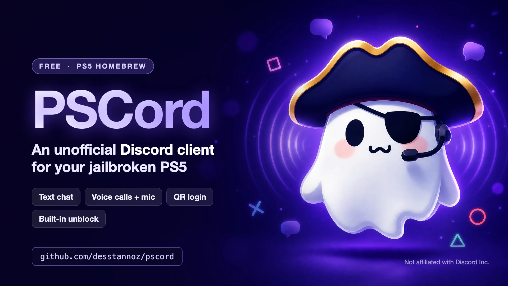
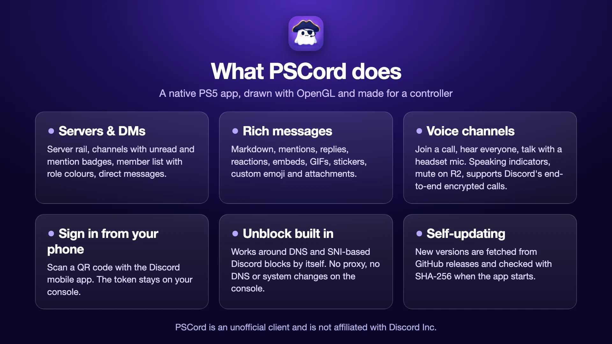
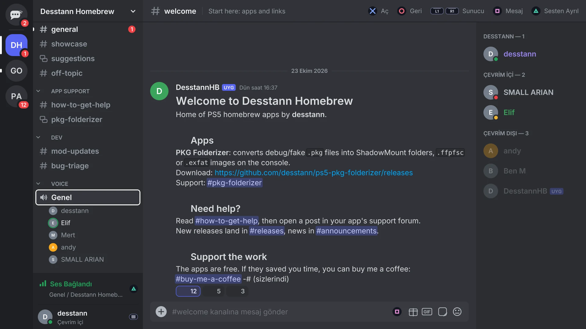
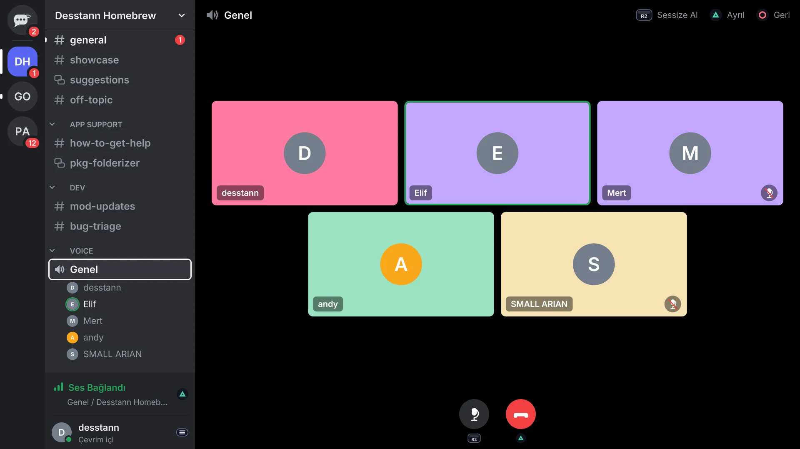

  

# PSCord for PS5

A native Discord client for the jailbroken PS5. It is a standalone homebrew app, drawn with OpenGL and built around the controller.

**Downloads:** [desstannsoftware.com](https://desstannsoftware.com/#pscord) · **Source / PRs:** this repository · **Chat:** [Desstann Homebrew Discord](https://discord.gg/wfTch3qUa6)

> PSCord is unofficial and is not affiliated with Discord Inc. Discord's terms do not allow third-party clients, so use it at your own risk.

  

## Features

- **Servers and DMs**: server rail, channels with unread and mention badges, member list with role colours, direct messages.
- **Messages drawn like the desktop client**: markdown, mentions, replies, reactions, embeds, GIFs, stickers, custom emoji, attachments and avatars.
- **Write messages** with an on-screen keyboard (Square).
- **Voice channels**: join a call, hear everyone and talk with a headset mic. Call screen with a tile per person and speaking and muted marks, R2 to mute, Triangle to leave. Discord's end-to-end encrypted (DAVE) calls are supported.
- **Sign in from your phone**: scan the QR code with the Discord mobile app. The token stays on the console.
- **Built-in unblock**: works around DNS and SNI-based Discord blocking inside the app (split TLS handshake, unfiltered DNS). No proxy and no system changes on the console.
- **Self-updating**: on launch it checks for a new version, verifies the download with SHA-256 and restarts into the new version.
- **Coming back to a call**: if the console suspended PSCord, it rejoins the voice channel when Discord reconnects, and mentions and direct messages raise a system notification.
- **Community**: every few launches, and from Settings, PSCord offers [Desstann Homebrew](https://discord.gg/wfTch3qUa6).

## Roadmap

Checklist of work still ahead. PRs that move any of these forward are welcome.

### Background voice
- [ ] Stable background audio via process-local PartyDaemon inject (replace fragile ptrace-per-grain pumping)
- [ ] Idle silence, pump re-inject on PartyDaemon restart, and clear “in call in the background” UI state

### Game streaming
- [ ] Watch Discord Go Live / Activity streams (video decode + overlay)
- [ ] Share the PS5 screen to Discord Go Live (capture → encode → gateway)

### Security
- [ ] Protect the on-console session token (encrypt `session.txt` or equivalent)
- [ ] Harden LAN web login (`:8090`) with TLS or a one-time code instead of cleartext token handoff

### Voice UX
- [ ] Deafen, server mute, push-to-talk / headset routing, and stage channels

### Chat and media
- [ ] Edit and delete messages, file upload, threads, slash commands / sticker picker
- [ ] Play video attachments; improve GIF and large-embed performance

### Project hygiene
- [ ] Publish a CI ccache snapshot; keep the public repo in sync with the private app tree
- [ ] Keep this roadmap and `docs/PARTY_DAEMON_BG_VOICE.md` accurate as background voice lands

## Screenshots

  
  

These are rendered from the app's own interface code with sample data (made-up users and messages). The interface is available in English and Turkish, switchable in the settings.

## Install

1. Download `PPSA99190.zip` from [desstannsoftware.com](https://desstannsoftware.com/#pscord) or from a [GitHub Release](https://github.com/desstannsoftware/pscord/releases).
2. Extract it and copy the `PPSA99190` folder to `/data/homebrew/`.
3. **PSCord** appears on the home screen, like the other apps in that folder.

## Contributing (PRs welcome)

Pull requests are welcome. **You do not need a local PS5 toolchain.** GitHub Actions builds every PR and push to `main`:

1. Fork and open a PR against `main`.
2. Wait for the **Build** check (lint, host tests, packaged `PPSA99190.zip`).
3. Download the Actions artifact (`pscord-PR…`) to try the build on a console if you can.

Details: [CONTRIBUTING.md](CONTRIBUTING.md) and [docs/PULL_REQUEST_BUILDS.md](docs/PULL_REQUEST_BUILDS.md).

A version tag matching `sce_sys/param.json` `contentVersion` (`NN.NNN.NNN`) publishes a GitHub Release from CI. OTA upload to desstannsoftware.com is maintainer-only.

## Licence

GPL-3.0-or-later (see [LICENSE](LICENSE) and [THIRD_PARTY_NOTICES.md](THIRD_PARTY_NOTICES.md)). Built on [ps5-homebrew-ui](https://github.com/blackbearreloaded/ps5-homebrew-ui) and [ps5-native-app-boilerplate](https://github.com/blackbearreloaded/ps5-native-app-boilerplate).

## Support

Questions and bug reports: [Desstann Homebrew Discord](https://discord.gg/wfTch3qUa6) or [GitHub Issues](https://github.com/desstannsoftware/pscord/issues).

PSCord is free. If it is useful, you can [buy me a coffee](https://buymeacoffee.com/desstann).

